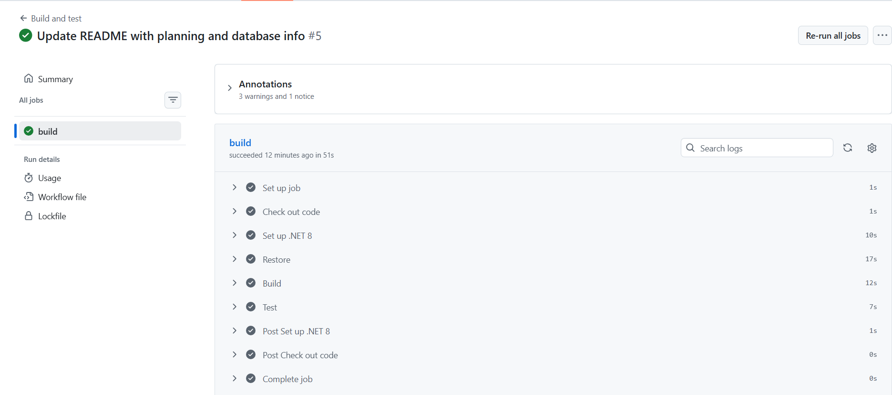

# RaceDay Event Management System (API)
 Part 1 (planning and database) : see the https://github.com/AnneSparklesl/RaceDay-Event-Management/tree/main/docs folder for the erd api plan , sql script.
 
 Part 2 (updated planning documents): See the [/docs](./docs) folder for the updated ERD, API plan and SQL script.

A REST API for organising running, walking and cycling events, built with ASP.NET Core (.NET 8), Entity Framework Core and SQL Server. Organisers create venues, events and categories and record results. Participants enrol in events and view their own results.

## Tech stack
- .NET 8 Web API with Swagger (OpenAPI)
- Entity Framework Core (code-first) with SQL Server
- Server-side session authentication with BCrypt password hashing
- xUnit tests using the EF Core InMemory database
- GitHub Actions for continuous integration

## Project structure
```
Controllers/          API endpoints (Auth, Users, Venues, Events, Categories, Enrolments, Results)
DTOs/                 Request shapes sent to the API
Filters/              SessionAuthorize attribute that enforces login and roles
Models/               Entity classes (match the Part 1 ERD)
data/                 ApplicationDBContext
Migrations/           EF Core migrations that create the database
API_prog.API.Test/    xUnit unit tests
.github/workflows/    GitHub Actions workflow (build and test)
```

## Setup and run
1. Install the .NET 8 SDK, Visual Studio 2022 and SQL Server (LocalDB works) with SSMS.
2. Clone the repository and open `API_proj.sln`.
3. Open `appsettings.json`. The `DefaultConnection` string points to `(localdb)\MSSQLLocalDB` and a database called `RaceDayDb`. Change the server name if yours is different.
4. Create the database from the migration. In **Tools > NuGet Package Manager > Package Manager Console**, set the default project to `API_proj` and run:
```
Update-Database
```
5. Press the green **https** button in Visual Studio to start the API.
6. Swagger opens at `https://localhost:7022/swagger`.
7. Register users and log in (see below). Log in again whenever you restart the API, because sessions are kept in memory.

## Roles
- **Organiser:** creates, updates and deletes venues, events and categories; records, updates and deletes results for their own events; views the enrolments for their own events.
- **Participant:** views events and categories, enrols in an event by choosing a category, views and cancels their own enrolments, and views their own results.

Both roles can view and update their own profile. Log in with `POST /api/auth/login`. Swagger keeps your session cookie, so the protected endpoints then work. Requests that are not logged in get 401, and requests from the wrong role get 403.

## Test accounts
The database is empty after setup. Create these in Swagger with `POST /api/auth/register`:
- Organiser: `organiser@test.com` / `Password123`, role `Organiser`
- Participant: `participant@test.com` / `Password123`, role `Participant`

The unit tests create their own data, so they need no accounts.

## Running the tests
```
dotnet test
```
There are 30 xUnit tests covering registration and login, event management, role checks (wrong roles rejected) and enrolments, each with success and failure cases.

## Continuous integration
A GitHub Actions workflow (`.github/workflows/dotnet.yml`) builds the project and runs all the tests on every push.



## Differences from the Part 1 plan
- Login uses server-side sessions (a session cookie storing the user id and role) instead of bearer tokens.
- Event has two columns that were not in the Part 1 ERD and SQL script: `event_type` (Run, Walk or Cycle) and `distance_km`. The brief requires every event to have a type and a distance. The ERD and SQL script in `/docs` are updated to match. Category also keeps its own `distance_km`.
- All GET endpoints require a login (the plan listed some as public).
- `GET /api/enrolments` returns only the enrolments for the logged-in Organiser's own events.
- Organisers can only change or delete events, categories and results that belong to them.
- Extra endpoints beyond the plan: logout, and delete endpoints for enrolments and the user's own account.

## Video walkthrough
[Watch on YouTube (unlisted)](https://youtu.be/a8O-KbHQgX0)
